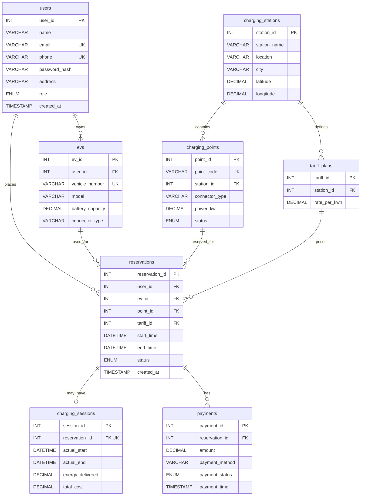

# Entity–Relationship Diagram

This ER diagram reflects the eight tables defined in `db/schema.sql`. Mermaid renders it in the GitHub Markdown preview.

## Relationship notes

- One user can own multiple EVs and create multiple reservations.
- One charging station contains multiple charging points and can define multiple tariff plans.
- Each reservation references exactly one user, EV, charging point and tariff plan.
- A reservation can have zero or one charging session because `charging_sessions.reservation_id` is unique.
- A reservation can have multiple payment records because `payments.reservation_id` is not unique.
- Foreign keys use restrictive deletion rules where historical records must be preserved.
- Vehicle registration number, user email and phone are unique.

## Relational schema

The authoritative relational schema is implemented in `db/schema.sql`; table attributes and constraints are described in [data-dictionary.md](./data-dictionary.md). Re-run this diagram against the schema if columns or relationships change.
